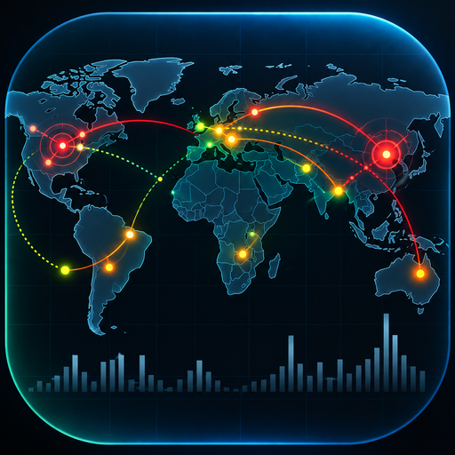
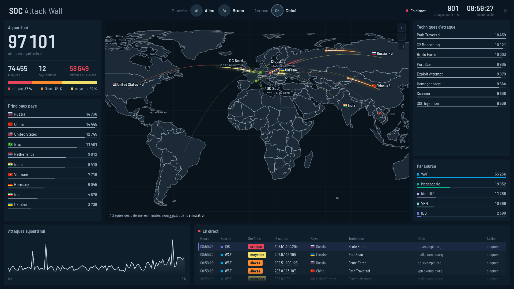

# SOC Attack Wall

An attack wall for SOC rooms, hosted in **Splunk** (Cloud or Enterprise):
live attack map, today's counters, feed of the latest events, on-duty team,
and replay of any moment of the day.

*Version française : [README.md](README.md).*



- **No server, no token**: a Splunk app. Scheduled searches compute, the
  dashboard displays. One computation every 5 minutes, however many screens.
- **Runs without data**: the app ships with 5 demo sources (generated with
  `makeresults`). Install it and the wall comes alive right away, then
  replace the sources one by one with yours.
- **Adapted through configuration**: title, logo, colours, protected sites,
  sources and their SPL searches all live in one file, `config/wall.json`.
- **Source templates** for common products (Ubika WAF, Check Point IPS,
  Proofpoint, Microsoft 365 sign-in failures, F5 APM VPN), each with a test set.
- **A configuration dashboard**: post-install checks, attack sources (add,
  validate, edit, delete, without rebuilding the app), analysts and photos,
  schedule, search status, troubleshooting.

The interface is available in **English** and **French** (`"language"` in the
configuration).

## Quick start

```bash
git clone https://github.com/soc-ops-cyber/soc-attack-wall && cd soc-attack-wall
python3 build.py --config config/wall.example.en.json   # -> dist/soc_attack_wall-<version>.tgz
xdg-open dist/apercu.html                               # the page alone, simulated, no Splunk needed
```

1. Install `dist/soc_attack_wall-<version>.tgz` in Splunk
   (*Apps > Manage Apps > Install app from file*).
2. The app opens on its **Configuration** page: follow the *Getting started*
   section.
3. Wait 10 minutes (two runs of the searches), then open the wall:
   `https://<your-splunk>/app/soc_attack_wall/wall`. Use this direct address
   on the display screen.

Requirements: Splunk Enterprise 8.1+ or Splunk Cloud; Python 3.8+ to build
(standard library only). The display account needs a `user` role that can
search the summary index. The package passes Splunk AppInspect (`cloud`
and `private_app` tags) with no error and no failure.

## Adapting it to your SOC

```bash
cp config/wall.example.en.json config/wall.json   # ignored by git
$EDITOR config/wall.json
python3 build.py --verifier                       # checks the configuration
python3 build.py                                  # new package
```

| Key | Purpose |
|---|---|
| `language` | `"en"` or `"fr"` |
| `app` | app id, label, version, roles allowed to edit the team (`roles_write`) and to see the configuration page (`roles_config`), `check_for_updates` (`true` for Splunkbase, which rejects `false`; `false` for a private build) |
| `page` | title, subtitle, logo (png/svg/jpg), accent colour (reserved for your sites), default map view |
| `sites` / `default_site` | protected sites the attacks converge to: `id`, `label`, `lat`, `lon`, `label_dir` |
| `sources` | `id`, `label`, `color`, `search_file`, optional `priority` (pinned in the feed), `lookback_minutes` |
| `origins` | `exclude_countries` (dropped), `ranking_exclude_countries` (counted, not ranked), `masked_labels` |
| `burst_cap`, `summary_index` | arcs per burst and per batch (20), summary index (`summary`) |

Sources can also be added, edited or removed from the **Attack sources**
section of the configuration page, without rebuilding the app.

### Source contract

A source is an SPL search, scheduled every 5 minutes over `-7m@m → -2m@m`,
that returns **one event per attack** with these fields:

| Field | Content |
|---|---|
| `_time` | time of the attack |
| `src_ip` | attacker IP (geolocated with `iplocation`) |
| `dc` | id of the targeted site (one of `sites[].id`; unknown ids go to `default_site`) |
| `severity` | `critical`, `high`, `medium`, `low` or `informational` (anything else counts as `medium`) |
| `signature` | attack type shown on the wall |
| `dest_host` | target shown in the feed (optional) |
| `action` | `blocked`, `allowed`, `alerted`, `detect`… (optional) |

End it with
`| fields _time, src_ip, Country, src_lat, src_lon, dc, severity, signature, dest_host, action`.
`build.py` appends geolocation, site coordinates, normalisation and a control
row. To force an origin (traffic relayed by a CDN or proxy), set `Country` to a
label listed in `origins.masked_labels` and leave `src_lat`/`src_lon` empty.
For logs spread over time, set `lookback_minutes` and keep only the batch with
`| where _time >= $WINDOW_START$`. Full details, in French:
[docs/CONTRAT.md](docs/CONTRAT.md).

## Tests

```bash
python3 -m unittest discover -s tests -v            # offline, no Splunk needed

export SPLUNK_URL=https://your-splunk:8089 SPLUNK_TOKEN=...
python3 tests/splunk/run.py --sans-appli            # SPL test sets (read-only)
```

The SPL test sets replay each source template on fictitious events
(`templates/sources/*/fixture.spl`) and compare the result with
`attendu.json`; they also check your own sources against the contract. They
read no index and write nothing.

## Translations

The code is written in French. `i18n/en.json` maps every displayed French text
to its English translation; `build.py` applies it to strings only (never to
code) when `"language": "en"`. The tests fail if an English build still
contains French text or if a dictionary entry no longer matches anything.
Adding a language means adding `i18n/<lang>.json` and its locale in `i18n.py`.

Note: the source templates emit some French signature names (e.g. the
Microsoft 365 template); adjust them in your copy of the search.

## Repository layout

| Path | Content |
|---|---|
| `config/wall.example.en.json` | English demo configuration, starting point for yours |
| `config/sources/demo/` | demo sources (`makeresults` generators) |
| `templates/sources/` | source templates per product, with test sets |
| `web/index.html` | the wall page (also opens alone, simulated) |
| `splunk_app/src/` | Splunk reader, configuration dashboard |
| `i18n/` | translations |
| `build.py` | builds the app and the preview |
| `tests/` | offline tests and SPL test sets |
| `docs/` | detailed documentation (French) |

## Licences

Code under the MIT licence (see [LICENSE](LICENSE)). Barlow Semi Condensed
font: SIL Open Font License 1.1. Flags: Twemoji, CC-BY 4.0, © Twitter, Inc.
and contributors. Borders: Natural Earth (public domain).
